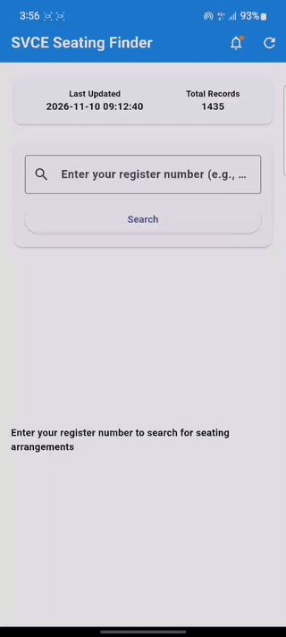

# 🎓 SVCE Seating Arrangement Finder

<p align="center">
  
</p>

<p align="center">
  <b>A comprehensive, production-ready mobile and web solution for Sri Venkateswara College of Engineering (SVCE) students to instantly look up exam seating arrangements, hall allocations, and seat numbers.</b>
</p>

<p align="center">
  
  
  
  
  
  
</p>

---

## 📱 Mobile App Demo

<p align="center">
  
</p>
<p align="center"><i>Live Flutter mobile app in action — instant search, seat highlights, and exam notifications.</i></p>

---

## 🌟 Key Highlights & Features

- 🔍 **Instant Register Number Search**: Rapid search with auto-complete that highlights hall numbers, seat rows, and exam session info.
- ⏰ **Automated Exam Reminders**: Integrated background service (`flutter_background_service`) and local notification alarms (`flutter_local_notifications`) to alert students before exam start.
- 📦 **Offline Support & Bundled Data**: Built-in cached database so students can find their seats even with low campus connectivity.
- 📄 **Automated PDF Parsing**: Automatically scrapes SVCE's examination portal and extracts tabular seating data from official PDFs with `pdfplumber` and `Syncfusion PDF`.
- 🔄 **Real-Time Data Refresh**: One-click backend scraping triggers synchronization with newly published seating lists.
- 🎨 **Material 3 Modern UI**: Adaptive design with smooth micro-interactions, dark/light theme support, and responsive layouts for both mobile and web.
- 🚀 **Cloud Deployment Ready**: Preconfigured with `render.yaml` for zero-configuration deployment on Render.

---

## 🏗️ System Architecture

```
svce-seating-arrangements-Finder/
├── lib/                             # Flutter Mobile Application
│   ├── main.dart                    # App bootstrap & background worker init
│   ├── models/                      # Seating & Reminder data models
│   ├── screens/                     # Home, Search, & Reminder Setup screens
│   └── services/                    # API, Notification, & Background services
├── android/                         # Native Android project configuration
├── ios/                             # Native iOS project configuration
├── backend/                         # Flask REST API & Web Scraper
│   ├── app.py                       # API endpoints & PDF scraping engine
│   ├── seating_data.json            # Parsed seating dataset
│   └── test_parser.py               # PDF parser tests
├── frontend/                        # Web Interface
│   ├── index.html                   # Web application UI
│   ├── script.js                    # Web search client
│   └── style.css                    # Responsive CSS styling
├── SVCE_Seating_Finder.apk          # Pre-compiled Android Release package
├── demo.gif                         # Animated app preview for README
├── icon.png                         # Application icon
├── pubspec.yaml                     # Flutter dependencies
├── requirements.txt                 # Python backend dependencies
└── render.yaml                      # Render cloud deployment config
```

---

## 🚀 Quick Start Guide

### 1. Download & Install Android App (Direct APK)

You can directly install the pre-compiled Android application:
- 📲 **Download APK**: [`SVCE_Seating_Finder.apk`](SVCE_Seating_Finder.apk) directly from this repository and install on any Android device.

---

### 2. Running the Flutter Mobile App (Development)

**Prerequisites**: [Flutter SDK](https://docs.flutter.dev/get-started/install) (3.0+) and Android Studio / VS Code.

```bash
# Get dependencies
flutter pub get

# Run on connected device or emulator
flutter run

# Build release APK
flutter build apk --release
```

---

### 3. Running the Backend Server

**Prerequisites**: Python 3.9+

```bash
# 1. Create and activate a virtual environment
python -m venv .venv
source .venv/bin/activate    # On Windows: .\.venv\Scripts\Activate.ps1

# 2. Install dependencies
pip install -r requirements.txt

# 3. Start the Flask API
python backend/app.py
```
The backend API will be available at `http://localhost:10000`.

---

### 4. Running the Web Frontend

Simply open `frontend/index.html` in any modern web browser, or serve it with Python:

```bash
cd frontend
python -m http.server 8000
```
Then navigate to `http://localhost:8000`.

---

## 📡 Backend API Reference

| Endpoint | Method | Description |
| :--- | :---: | :--- |
| `/` | `GET` | Health status and API discovery |
| `/health` | `GET` | Health check endpoint for uptime monitoring |
| `/api/search?register_no=<reg_no>` | `GET` | Retrieve student's exam hall and seat details |
| `/api/stats` | `GET` | Get total seating records and last update timestamp |
| `/api/refresh` | `POST` | Trigger scraper to fetch and parse latest SVCE PDFs |

---

## ☁️ Deployment on Render

This project is configured for automated deployment via [Render](https://render.com/):

1. Connect your GitHub repository to Render.
2. Select **Web Service** using `render.yaml` or set:
   - **Environment**: `Python 3`
   - **Build Command**: `pip install -r requirements.txt`
   - **Start Command**: `gunicorn backend.app:app`
   - **Health Check Path**: `/health`
3. Point your web frontend (`frontend/script.js`) or Flutter app (`api_service.dart`) to your Render live URL.

---

## 🛠️ Built With

- **Mobile**: [Flutter](https://flutter.dev/) & [Dart](https://dart.dev/)
- **Backend**: [Flask](https://flask.palletsprojects.com/), [Gunicorn](https://gunicorn.org/)
- **Scraping & Parsing**: [BeautifulSoup4](https://www.crummy.com/software/BeautifulSoup/), [pdfplumber](https://github.com/jsvine/pdfplumber), [Syncfusion Flutter PDF](https://pub.dev/packages/syncfusion_flutter_pdf)
- **Background Tasks & Notifications**: [flutter_local_notifications](https://pub.dev/packages/flutter_local_notifications), [flutter_background_service](https://pub.dev/packages/flutter_background_service)
- **Deployment**: [Render](https://render.com/)

---

## 📄 License

This project is licensed under the MIT License - feel free to use and adapt for academic and educational purposes.
